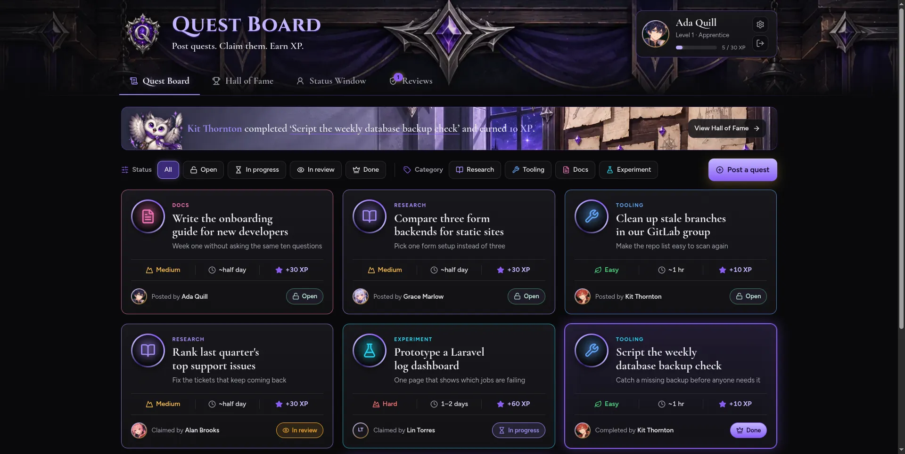
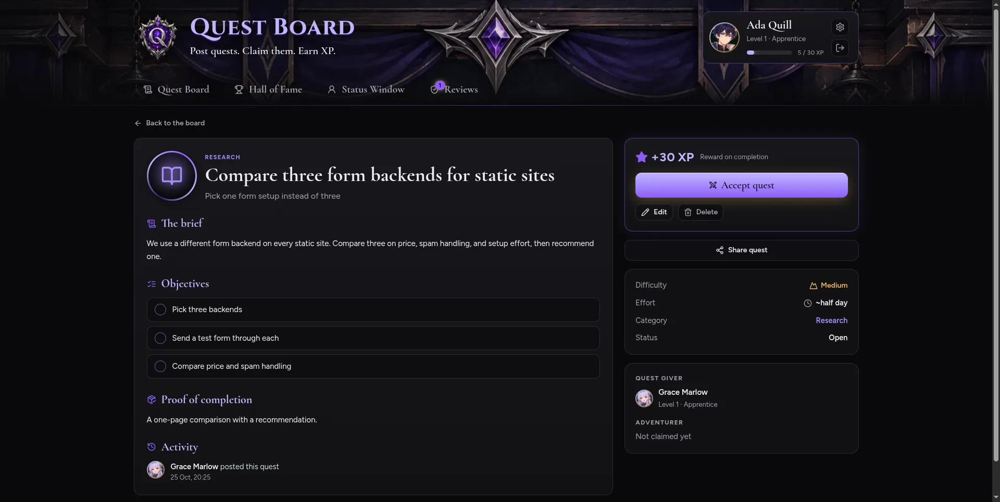
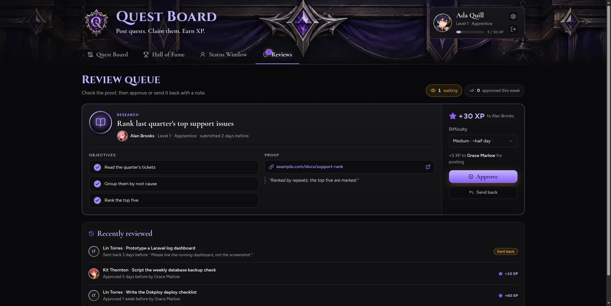

# Quest Board

A quest board for your team. People post tasks as quests, volunteers claim them, and leads approve the results for XP. It is self-hosted, with one install per team.

| Board                                                                                         | Quest page                                                                               | Review queue                                                                            |
| --------------------------------------------------------------------------------------------- | ---------------------------------------------------------------------------------------- | --------------------------------------------------------------------------------------- |
|  |  |  |

## Features

- **Quests**: post a quest with a category, difficulty, objectives and proof of completion. Claim it, turn it in with a link or note, and a lead approves it or sends it back.
- **XP and levels**: Easy, Medium and Hard quests give 10, 30 and 60 XP. Posters earn +5 XP when their quest is done. Six levels, from Apprentice to Legend.
- **Badges**: five badges with progress bars.
- **Review queue**: leads see what is waiting and can change the difficulty before approving.
- **Hall of Fame**: monthly highlights, top players and recent completions.
- **Reward moments**: a "Quest complete" and "Level up!" pop-up the next time someone opens the board.
- **Accounts and roles**: member, lead and admin. Admins add people and pick their portraits. There is no sign-up page.
- **Branding**: admins set the app name, logo, banner, favicon and theme in Settings.
- **Dark look only**, with animations that respect reduced-motion settings.

## Quick start with Docker

You need Docker with Compose. Nothing else.

```bash
git clone https://github.com/guildquests/quest-board.git
cd quest-board
cp .env.example .env
```

Open `.env` and set at least these:

- `APP_KEY`: generate it once with `echo "base64:$(openssl rand -base64 32)"` and paste the output.
- `APP_URL`: the address people will open, for example `https://quests.example.com`.
- `DB_PASSWORD`: a long random password.

Then start everything:

```bash
docker compose up -d
```

The first start builds the image, which takes a few minutes. The app runs the database migrations by itself. It listens on port 8080 (change it with `WEB_PORT`). Put a reverse proxy in front of it for HTTPS.

Behind a reverse proxy: set `APP_URL=https://...` and `SESSION_SECURE_COOKIE=true`, keep `WEB_BIND=127.0.0.1`, and point the proxy at `127.0.0.1:8080`. For a proxy on another machine (such as CloudFront), set `WEB_BIND=0.0.0.0` and a firewall that only lets that proxy in. See [docs/deploy.md](docs/deploy.md#4-https-and-a-domain).

## Create the first admin

```bash
docker compose exec app php artisan quests:create-admin
```

It asks for a name, email and password. In production the password needs at least 12 characters with mixed case, numbers and symbols. Then sign in and add everyone else in **Settings > Members**.

## Branding

Open **Settings > Branding** as an admin to change the app name, tagline, logo, banner, favicon and theme preset. Changes show right away.

## Deploying on Dokploy

Use the same `docker-compose.yml`. Create a Docker Compose service from this repo, turn on Isolated Deployment, paste your `.env`, and add your domain to the `app` service on port 8080. See [docs/deploy.md](docs/deploy.md) for the full steps, logs and updating.

## Local development

Development runs in [Laravel Sail](https://laravel.com/docs/sail) (PHP 8.4 and MySQL). The host needs Docker only; PHP, Composer and npm all run inside Sail.

```bash
# Install Composer dependencies (no PHP needed on the host)
docker run --rm -u "$(id -u):$(id -g)" -v "$(pwd):/var/www/html" -w /var/www/html \
    laravelsail/php84-composer:latest composer install --ignore-platform-reqs

cp .env.example .env
```

`docker-compose.yml` is the production stack, so Sail uses its own file. In `.env`, keep `SAIL_FILES=compose.sail.yaml` and uncomment the Sail block at the bottom of `.env.example` (`APP_ENV=local`, `APP_DEBUG=true`, `APP_PORT`, `APP_URL`). Set `DB_PASSWORD` too. Then:

```bash
./vendor/bin/sail up -d
./vendor/bin/sail artisan key:generate
./vendor/bin/sail npm install
./vendor/bin/sail artisan migrate:fresh --seed
./vendor/bin/sail npm run dev
```

The seeder creates demo people such as `admin@example.com`, all with password `password`. Never run the seeder on a real install. To run a public demo that resets every night, see "Running a public demo" in [docs/deploy.md](docs/deploy.md). Keep `DEMO_MODE` off on a real install.

Run all checks (Pint, Larastan, the test suite, ESLint, Prettier, TypeScript and the Vite build):

```bash
./vendor/bin/sail composer test && ./vendor/bin/sail npm run lint:check && ./vendor/bin/sail npm run format:check && ./vendor/bin/sail npm run types:check && ./vendor/bin/sail npm run build
```

## Tech stack

Laravel 13, Inertia v3, React 19, TypeScript, Tailwind CSS 4, shadcn/ui, Laravel Fortify, Wayfinder, MySQL, and [serversideup/php](https://serversideup.net/open-source/docker-php/) for the production image.

## Credits and license

Quest Board is released under the [MIT License](LICENSE), copyright 2026 Yan Linn Thor.

Fonts, icons, music and the AI-generated artwork are credited in [LICENSES.md](LICENSES.md).
